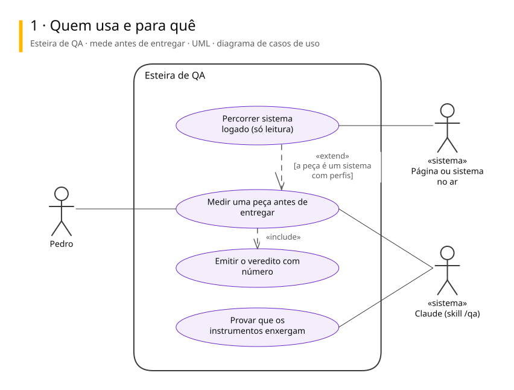
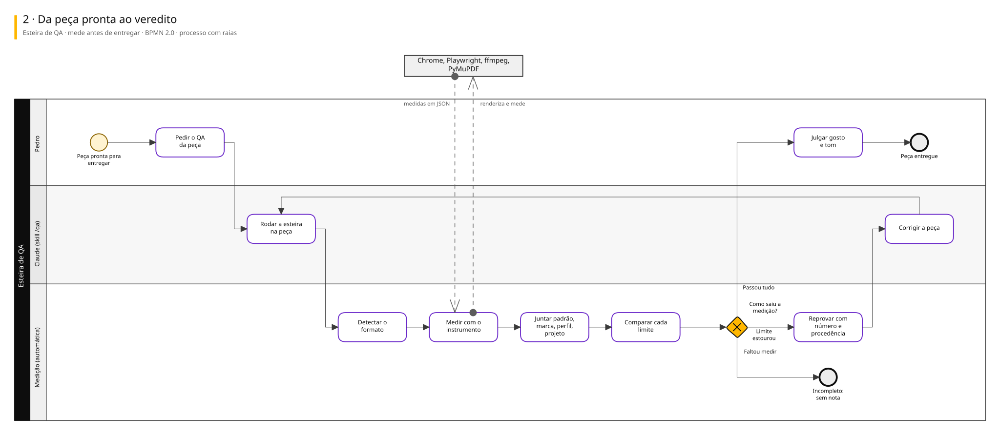
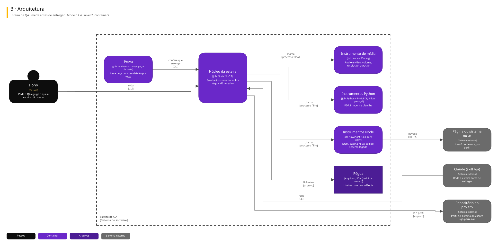

# Arquitetura

Três vistas do sistema, cada uma numa notação padrão.

| Vista | Notação | Responde |
|---|---|---|
| 1. Casos de uso | UML | Quem usa e para quê |
| 2. Processo | BPMN 2.0 | Como o trabalho anda, com uma raia para cada quem executa |
| 3. Arquitetura | C4, nível 2 | De que partes o sistema é feito e com quem conversa |

## Esteira de QA · mede antes de entregar

Um comando que mede qualquer peça (PDF, HTML, imagem, áudio, vídeo, planilha, página no ar, código, sistema logado) e reprova o que está quebrado, com régua universal, da marca e do projeto. Ela reprova, não aprova: gosto e tom ficam com o Pedro.

### 1. Quem usa e para quê

### 2. Da peça pronta ao veredito

### 3. Arquitetura

Para editar: [esteira-de-qa.excalidraw](./esteira-de-qa.excalidraw), que abre em [excalidraw.com](https://excalidraw.com) ou na extensão Excalidraw do VS Code.

## De onde vêm

Os diagramas são gerados a partir do Sinapse, o vault onde o Pedro organiza notas e projetos. Mudança feita direto aqui some na próxima publicação: o lugar de mudar é a especificação no Sinapse.
