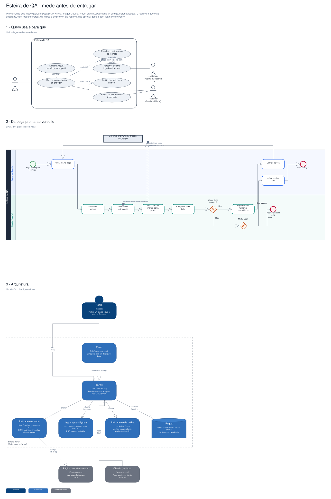

# Arquitetura

Diagramas gerados a partir do Sinapse (o segundo cérebro do Pedro). Cada projeto tem três vistas,
cada uma numa notação padrão:

1. **Quem usa e para quê**: UML, diagrama de casos de uso.
2. **O processo principal**: BPMN 2.0, com raias por quem executa.
3. **A arquitetura**: modelo C4, nível 2 (containers).

## Esteira de QA · mede antes de entregar

Um comando que mede qualquer peça (PDF, HTML, imagem, áudio, vídeo, planilha, página no ar, código, sistema logado) e reprova o que está quebrado, com régua universal, da marca e do projeto. Ela reprova, não aprova: gosto e tom ficam com o Pedro.

Editável: [`esteira-qa.excalidraw`](./esteira-qa.excalidraw), abre em [excalidraw.com](https://excalidraw.com) ou no VS Code com a extensão Excalidraw.

A fonte destes arquivos é o vault do Sinapse (`09-DESENHOS/`); alterações feitas aqui são sobrescritas na próxima publicação.
